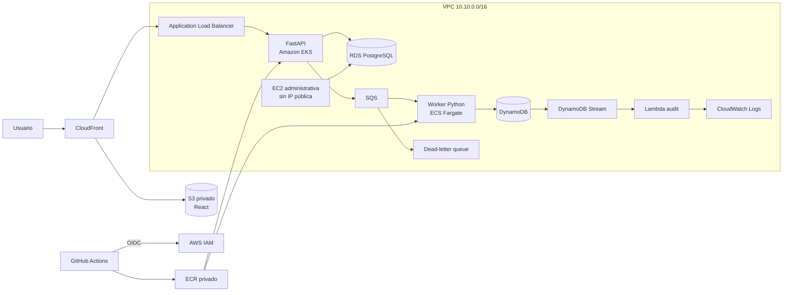

# TicketFlow AWS Platform

Plataforma web de reservas construida como laboratorio integral de arquitectura
AWS. Una reserva ingresa por React y FastAPI, se persiste en PostgreSQL y se
procesa de forma asíncrona mediante SQS y un worker en ECS Fargate. El resultado
se guarda en DynamoDB y sus cambios se auditan con Lambda.

El repositorio demuestra cómo diseñar, reconstruir, probar y desplegar una
plataforma distribuida con Infrastructure as Code, contenedores, Kubernetes y
CI/CD sin credenciales AWS permanentes en GitHub.

## Resultado

- Frontend React distribuido con S3 privado y CloudFront.
- API FastAPI con dos réplicas en Amazon EKS.
- Application Load Balancer administrado desde Kubernetes.
- PostgreSQL privado en Amazon RDS.
- Procesamiento asíncrono con SQS, DLQ y ECS Fargate.
- Estado de tickets en DynamoDB y auditoría con Streams + Lambda.
- Infraestructura modular y reproducible con Terraform.
- CI con tests, lint, builds y análisis de seguridad.
- CD autenticado en AWS mediante GitHub OIDC.
- Recuperación automatizada cuando cambia la cuenta del sandbox.

## Arquitectura



### Flujo de una reserva

1. El usuario completa el formulario React servido por CloudFront.
2. CloudFront dirige `/api/*` al ALB y el contenido estático al bucket S3.
3. La API en EKS crea la reserva en RDS PostgreSQL.
4. La API publica `TicketGenerationRequested` en SQS y responde `202 QUEUED`.
5. El worker en ECS Fargate consume el mensaje mediante long polling.
6. El worker procesa el ticket de forma idempotente y guarda el resultado en
   DynamoDB.
7. DynamoDB Streams invoca la Lambda de auditoría y genera logs en CloudWatch.
8. Los mensajes que agotan sus reintentos terminan en la DLQ.

## Por qué esta arquitectura

| Decisión | Motivo |
|---|---|
| EKS para la API | Practicar Kubernetes administrado, health checks, réplicas, rollout, PDB e Ingress. |
| ECS Fargate para el worker | Ejecutar trabajo asíncrono sin administrar servidores ni mezclarlo con el ciclo HTTP. |
| SQS + DLQ | Desacoplar API y worker, absorber picos y aislar mensajes fallidos. |
| RDS PostgreSQL | Mantener el modelo transaccional de reservas con consistencia relacional. |
| DynamoDB | Conservar el resultado operativo del ticket con acceso simple y escalable. |
| Lambda + Streams | Auditar cambios sin acoplar esa responsabilidad al worker. |
| S3 + CloudFront | Publicar el frontend sin servidores, con bucket privado y caché global. |
| Terraform modular | Hacer explícitas las dependencias y reconstruir el entorno de forma repetible. |
| GitHub OIDC | Usar credenciales temporales y evitar access keys permanentes en GitHub. |

La combinación es deliberadamente amplia porque el proyecto es un laboratorio
de arquitectura. En un producto pequeño se podrían reducir componentes para
optimizar costo y operación.

## Reconstrucción desde cero

Esta es la ruta recomendada para evaluar el proyecto. El script fue diseñado
para cuentas sandbox descartables y es reejecutable: reconoce recursos ya
creados y continúa desde la etapa pendiente.

### Requisitos

- Linux o WSL con Bash.
- Cuenta AWS activa con permisos para crear los servicios declarados.
- AWS CLI autenticada en `us-east-1`.
- Terraform `>= 1.15.0, < 2.0.0`.
- Docker, Python 3.12, Node.js 22, Git y GitHub CLI.
- `kubectl`, Helm, jq, curl, sed, grep, Trivy y Gitleaks.
- GitHub CLI autenticada con acceso al repositorio.

Verificación inicial:

```bash
aws sts get-caller-identity
aws configure get region
gh auth status
docker info >/dev/null
git status --short
```

La región debe ser `us-east-1` y el working tree debe estar controlado antes de
comenzar.

### Bootstrap completo

Desde la raíz del repositorio:

```bash
./scripts/bootstrap-sandbox.sh
```

El proceso:

1. Detecta cuenta AWS, región e IP pública.
2. Migra las referencias del backend cuando cambia la cuenta.
3. Crea el bucket S3 de Terraform state y migra el state.
4. Prueba y empaqueta la Lambda.
5. Crea ECR y publica imágenes iniciales escaneadas con Trivy.
6. Despliega red, seguridad, RDS, DynamoDB, SQS, Lambda, ECS y EKS.
7. Instala AWS Load Balancer Controller con Helm.
8. Genera la configuración runtime y aplica Kustomize.
9. Ejecuta la migración de base de datos y espera el rollout de la API.
10. Crea S3, CloudFront y la identidad OIDC de GitHub.
11. Actualiza `AWS_ROLE_ARN` en el environment `dev` de GitHub.
12. Comprueba que el plan final de Terraform quede sin cambios.

El script solicita confirmaciones antes de crear el backend y aplicar
infraestructura. También rechaza planes dirigidos que contengan destrucciones.

Si la IP pública cambia durante el proceso y EKS deja de responder, se vuelve a
ejecutar el mismo comando. El script actualiza el CIDR y continúa sin recrear
lo que ya existe.

La explicación detallada y la recuperación ante fallos están en
[Reconstrucción del sandbox](docs/sandbox-bootstrap.md).

### Guardar y desplegar la configuración nueva

Al finalizar:

```bash
aws eks update-kubeconfig --region us-east-1 --name ticketflow-dev
terraform -chdir=terraform/environments/dev plan
git diff --check
gitleaks dir . --redact --no-banner
```

Terraform debe responder `No changes`. Luego se versionan únicamente los
cambios intencionales y se ejecuta:

```bash
git push
```

Ese push inicia automáticamente:

```text
CI correcto → token OIDC temporal → CD → ECR/Lambda/ECS/EKS/S3/CloudFront
```

Una cuenta completamente nueva requiere el bootstrap inicial porque todavía no
existe el proveedor OIDC. Después, los cambios de aplicación se publican con un
solo `git push`.

## Cómo probar el sistema

### 1. Salud de infraestructura

```bash
terraform -chdir=terraform/environments/dev plan
kubectl get nodes
kubectl get pods -n ticketflow
kubectl get ingress ticketflow-api -n ticketflow -o wide
```

Resultado esperado:

- Terraform: `No changes`.
- Dos nodos EKS en estado `Ready`.
- Dos pods de API `Running` y `1/1`.
- Job de migración `Completed`.
- Ingress con hostname de ALB.

### 2. Health check de la API

```bash
ALB_HOST="$(
  kubectl get ingress ticketflow-api \
    --namespace ticketflow \
    --output jsonpath='{.status.loadBalancer.ingress[0].hostname}'
)"

curl -fsS "http://${ALB_HOST}/health/live"
curl -fsS "http://${ALB_HOST}/health/ready"
```

Respuestas esperadas: `{"status":"ok"}` y `{"status":"ready"}`.

### 3. Flujo funcional completo

Crear una reserva:

```bash
RESPONSE="$(curl -fsS \
  -X POST "http://${ALB_HOST}/api/v1/reservations" \
  -H 'Content-Type: application/json' \
  -d '{
    "customer_name":"Portfolio Reviewer",
    "customer_email":"reviewer@example.com",
    "event_name":"AWS Architecture Day",
    "quantity":2
  }')"

echo "${RESPONSE}" | jq .
RESERVATION_ID="$(jq -r .reservation_id <<<"${RESPONSE}")"
```

Consultar la reserva:

```bash
curl -fsS \
  "http://${ALB_HOST}/api/v1/reservations/${RESERVATION_ID}" |
jq .
```

Validar el procesamiento en DynamoDB:

```bash
TABLE_NAME="$(
  terraform -chdir=terraform/environments/dev \
    output -raw dynamodb_table_name
)"

aws dynamodb query \
  --table-name "${TABLE_NAME}" \
  --key-condition-expression 'PK = :pk' \
  --expression-attribute-values \
    '{":pk":{"S":"RESERVATION#'"${RESERVATION_ID}"'"}}' |
jq .
```

El resultado esperado es `status = COMPLETED` con un `ticket_id`.

### 4. Tests y controles locales

```bash
PYTHONPATH=services/lambda-audit/src \
  python3 -m unittest discover -s services/lambda-audit/tests -v

PYTHONPATH=services/ticket-api/src \
  python3 -m unittest discover -s services/ticket-api/tests -v

PYTHONPATH=services/ticket-worker/src \
  python3 -m unittest discover -s services/ticket-worker/tests -v

npm ci --prefix services/frontend
npm run lint --prefix services/frontend
npm run build --prefix services/frontend

terraform fmt -check -recursive terraform
terraform -chdir=terraform/bootstrap init -backend=false
terraform -chdir=terraform/bootstrap validate
terraform -chdir=terraform/environments/dev init -backend=false
terraform -chdir=terraform/environments/dev validate

kubectl kustomize kubernetes/overlays/dev |
  tee /tmp/ticketflow-rendered.yaml >/dev/null
test -s /tmp/ticketflow-rendered.yaml

gitleaks dir . --redact --no-banner
```

## CI/CD

### Integración continua

Cada pull request y push a `main` ejecuta ocho controles independientes:

- Gitleaks sobre el historial y el repositorio.
- Tests de Lambda, API y worker.
- Lint, build y auditoría de dependencias del frontend.
- Formato y validación de Terraform.
- Render de manifiestos Kustomize.
- Build y análisis Trivy de las dos imágenes.
- Análisis Trivy de Terraform y Kubernetes.

### Despliegue continuo

CD sólo se inicia cuando CI termina correctamente. GitHub solicita un token
OIDC, AWS valida su `issuer`, `audience` y `subject`, y STS entrega credenciales
temporales al rol `ticketflow-dev-github-actions-cd`.

Con esas credenciales, el workflow:

1. Publica imágenes inmutables etiquetadas con el SHA del commit.
2. Actualiza Lambda.
3. Registra una nueva task definition y despliega el worker en ECS.
4. Autoriza temporalmente la IP del runner en el endpoint de EKS.
5. Despliega la API y restaura el CIDR original.
6. Construye el frontend, sincroniza S3 e invalida CloudFront.

La implementación y el modelo de confianza se explican en
[OIDC para GitHub Actions](oidc.md).

## Seguridad aplicada

- Sin credenciales AWS persistentes en GitHub.
- RDS, nodos EKS, tareas Fargate y EC2 administrativa en subredes privadas.
- EC2 administrativa sin IP pública, SSH ni key pair; acceso mediante SSM.
- Security groups referenciados entre sí y con flujos explícitos.
- Secret de RDS administrado por AWS Secrets Manager.
- Pod Identity para permisos de la API y Load Balancer Controller.
- Buckets S3 privados, acceso público bloqueado y CloudFront OAC.
- ECR privado, tags inmutables, escaneo al publicar y lifecycle policies.
- Contenedores ejecutados como usuario no root.
- DynamoDB con point-in-time recovery.
- SQS con cifrado, long polling, reintentos y DLQ.
- Logs con retención definida y auditoría estructurada.
- Gitleaks y Trivy como gates obligatorios de CI.

Las excepciones de análisis estático están documentadas en
[`.trivyignore.yaml`](.trivyignore.yaml); representan decisiones conscientes
del laboratorio, no hallazgos ocultos.

## Disponibilidad y operación

- Dos réplicas de API sobre dos nodos y dos zonas de disponibilidad.
- Readiness y liveness probes independientes.
- PodDisruptionBudget para preservar disponibilidad durante mantenimiento.
- Rolling updates de Kubernetes y circuit breaker con rollback en ECS.
- SQS desacopla el tráfico HTTP del trabajo de generación.
- CloudFront absorbe la entrega estática y reduce carga sobre el origen.
- CloudWatch concentra logs de Lambda y del worker.

## Costos y límites del entorno

El ambiente `dev` prioriza aprendizaje y capacidad de destrucción:

- Un NAT Gateway compartido.
- RDS `db.t4g.micro`, 20 GiB, Single-AZ y un día de backups.
- Dos nodos EKS `t3.medium` con autoscaling entre uno y tres.
- Un worker Fargate.
- Sin deletion protection y con `force_destroy` donde corresponde al sandbox.

EKS, NAT Gateway, RDS, Fargate, ALB y CloudFront generan cargos mientras están
activos. Para producción se deberían evaluar Multi-AZ, protección contra
borrado, KMS administrado por el cliente, WAF, observabilidad avanzada,
presupuestos y múltiples ambientes/cuentas.

## Estructura del repositorio

```text
.
├── .github/workflows/       # CI y CD
├── docs/                    # Operación y recuperación del sandbox
├── kubernetes/
│   ├── base/                # Recursos Kubernetes reutilizables
│   └── overlays/dev/        # Configuración Kustomize de dev
├── scripts/                 # Bootstrap, migración de cuenta y Lambda
├── services/
│   ├── frontend/            # React + TypeScript + Vite
│   ├── lambda-audit/        # Auditoría de DynamoDB Streams
│   ├── ticket-api/          # FastAPI + PostgreSQL + SQS
│   └── ticket-worker/       # Worker SQS + DynamoDB
└── terraform/
    ├── bootstrap/           # Backend remoto S3
    ├── environments/dev/    # Composición del ambiente
    └── modules/             # Módulos reutilizables
```

## API

| Método | Ruta | Propósito |
|---|---|---|
| `GET` | `/health/live` | Confirma que el proceso HTTP funciona. |
| `GET` | `/health/ready` | Confirma conectividad con PostgreSQL. |
| `POST` | `/api/v1/reservations` | Crea y encola una reserva. |
| `GET` | `/api/v1/reservations/{id}` | Consulta una reserva existente. |

FastAPI también expone documentación interactiva en `/docs`.

## Próximas mejoras

- Dominio propio, ACM y HTTPS en el ALB.
- AWS WAF para CloudFront y ALB.
- Métricas, dashboards, alarmas y trazas distribuidas.
- Autoscaling del worker basado en profundidad de SQS.
- Tests de integración y carga automatizados.
- Entornos `staging` y `production` con políticas más restrictivas.
- KMS customer-managed keys y rotación formal de secretos.

## Evidencias sugeridas para el portfolio

- Diagrama de arquitectura exportado a PNG/SVG.
- Captura del frontend y de una reserva procesada.
- Ejecuciones verdes de los ocho jobs de CI y del CD con OIDC.
- Pods EKS, servicio ECS y health checks saludables.
- Trivy y Gitleaks sin hallazgos bloqueantes.
- Prueba de carga con latencia, throughput y comportamiento de SQS.

## Autor

Walter Fontoura — proyecto de portfolio orientado a Cloud, DevOps, Platform
Engineering y arquitectura AWS.
